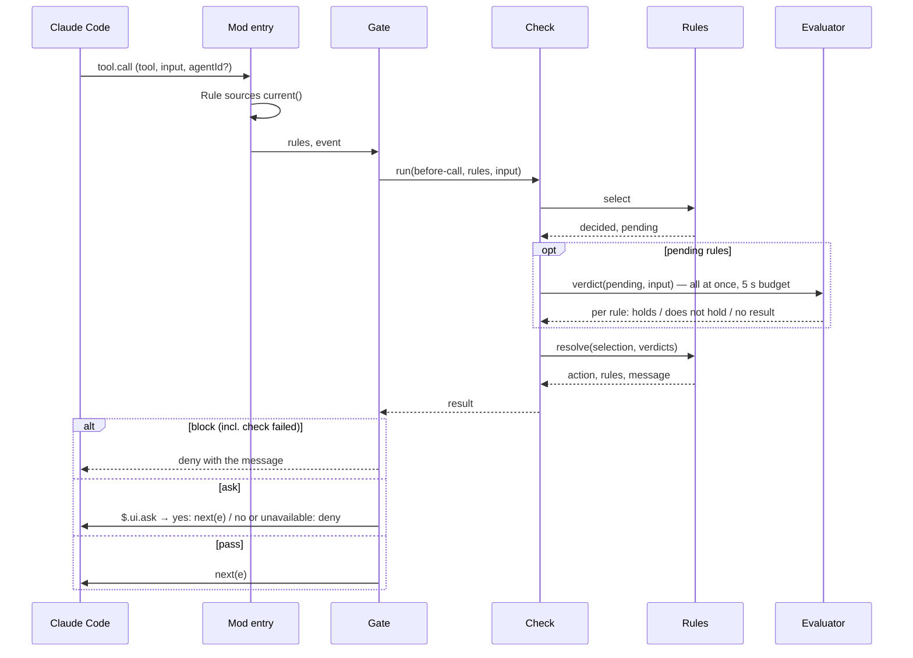

# Solution Design Document

> [!NOTE]
> This SDD answers **WHAT (design)** — the target architecture, components, interfaces, data
> changes, and the EARS behavior that makes "done" technical. It carries no code and no
> implementation sequencing (that is `/implement`'s job). Settled choices are **Decision** blocks;
> unresolved ones live in the **Open Questions** table at the foot of the document. Quality targets
> are the PRD's `NFR-N` gates — reference them, do not restate them.

> [!NOTE]
> **Version 2.0 (2026-10-11)** follows requirements v2.0: a local-only plugin. The service, sign-in,
> sync and rule repository are gone; ADR-3 and ADR-4 are retired with them, and ADR-1 and ADR-5 are
> revised. **Version 2.1 (2026-10-11)** applies the solution review: one Check unit, `resolve()` in
> Rules, a bounded project folder, ADR-7 revised, and evaluator findings shown to the user (research R3).

## Approach

cc-enforcer keeps the code Claude Code produces aligned with a project's own patterns, naming
conventions and quality gates. Developers keep their conventions as Hookify rule files; cc-enforcer
reads those files and enforces them through Claude Code Mods — an event-handler module Claude Code loads
in process — instead of hooks. It only ever adds checks the rules ask for.

cc-enforcer is one Claude Code plugin (ADR-1): a mod, a `rules` module that owns the rule format, and a
drafting skill. The mod enforces rules at four points, all through one Check unit:

1. **Before a tool call runs** (`tool.call`, before `next`): `block` and `ask` rules. Matcher conditions
   are decided in memory; an evaluator condition is answered with `$.model.classify` (ADR-2). If a check
   fails, the call does not run.
2. **After a tool call runs** (`tool.call`, after `next`; `turn.complete`): `warn` rules. Matcher-only
   findings ride along with the tool result as `context`, which Claude reads. `warn` rules with an
   evaluator are reviewed in one batch at the end of each agent's turn with `$.model.complete`; their
   findings are shown to the user, who can send them to Claude (research R3). cc-enforcer never starts a
   turn on its own.
3. **When Claude tries to end its turn** (`classic.Stop`, `classic.SubagentStop`): `stop` rules; a `block`
   keeps Claude working and gives it the message (research R1).
4. **When the user submits a prompt** (`prompt.submit`, before `next`): `prompt` rules; a `block` drops the
   prompt, a `warn` adds the message as context only Claude reads (research R1).

Rules are judged on the user's machine; evaluations go to the user's own model provider through the
session's own credentials. cc-enforcer runs no service.

- **Constraints:** Claude Code v2.1.287 or later (NFR-16); prompt-cache breakpoints for
  `$.model.complete` need v2.1.292, so they are used only when present. The band, `$.session.surfaces()` and
  `$.prompt.read/fill/submit` are feature-detected; where missing, findings go to the log only. The minimum
  version of every mods API used is recorded at build time from the generated types, and the NFR-16
  floor is raised if a required one (`tool.call`, `$.model.classify`, `$.ui.ask`) is newer. The mod module has no Node APIs:
  files, storage, timers and UI all go through the mods API (`$.fs`, `$.state`, `$.ui`, `$.prompt`).
  Types are generated from the installed Claude Code build (research F19).
- **Cross-cutting:**
  - Rule files are data; nothing in a rule is executed. Project rules arrive with any cloned repository;
    they apply only in a folder the user has trusted, which Claude Code enforces by loading no mod before
    its trust prompt is accepted (ADR-7, research R4).
  - Content being evaluated is passed to the model as clearly separated data (research F12).
  - Messages and findings are labelled as coming from cc-enforcer and the rule's name, never as the
    user's words (AC-8.3).
  - Rules are compiled once per change and matched in memory.
  - Observability is local: a per-session log and in-session hit counts.
- **Deployment:** the plugin is listed in a marketplace file at the repository root (git source).

**Quality gates realized** (PRD gate → how the design meets it → owning component):

| Gate | How the design meets it | Owner |
|------|-------------------------|-------|
| NFR-1, NFR-2 | Rules compiled once per change and matched in memory; an evaluator runs only after every matcher condition of its rule holds; before-call evaluation uses the small fast classifier; fields are matched on their first 32 KB | Rules, Evaluator |
| NFR-3 | Check alone turns an error, a timeout or a missing result on a hard rule into "check failed", which stops the call; its `.catch` backstop always denies | Check |
| NFR-4 | One `tool.call` handler sees main-session, subagent, MCP and background-agent calls | Gate |
| NFR-5, NFR-6 | Fixed classifier labels; fixed review rubric with separated data blocks and strict reply parsing | Evaluator |
| NFR-7 | `current()` compares each rule file's name, modification time and size at every event and recompiles on change | Rule sources |
| NFR-9 | Every message carries the rule's name and body; validation warns when the body names no alternative | Rules |
| NFR-13 | Works with zero configuration on existing Hookify files; `/cc-enforcer:draft` produces a first rule | Drafting skill |
| NFR-16 | CI runs the acceptance suite on v2.1.287 and on the latest release | Repository CI |
| NFR-17 | Match decisions and actions follow Hookify's documented format except the listed differences | Rules |

The gates are measured by the harness in `evals/`: reference sets and runners for NFR-1 – NFR-7, NFR-9
and NFR-17 (the Hookify set replays recorded tool calls, prompts and stops through both plugins and
compares decisions, excluding the PRD's listed differences).

## Read first

Context the implementer must read before building. Real paths only; one line on why each matters.

| Source | Why it matters |
|--------|----------------|
| `https://code.claude.com/docs/en/plugins/mods/events.md` | `tool.call` before and after `next`, `prompt.submit` (`drop`, `context`), `classic.*` events, `.catch` handlers, the order mods run in |
| `https://code.claude.com/docs/en/plugins/mods/api.md` | The model, prompt, UI, file and session calls the plugin uses |
| `https://code.claude.com/docs/en/plugins/mods/reference.md` | Limits: 10 s per hook (mods API waits such as `$.ui.ask` excluded), 1 s per `.catch`, 4 MiB files |
| `https://code.claude.com/docs/en/plugins/mods/create.md` | Plugin layout for a mod and generating the build's own types |
| `https://code.claude.com/docs/en/hooks.md` (Stop decision control) | What a `block` on Stop does, `stop_hook_active`, the continuation cap |
| Hookify's `skills/writing-rules/SKILL.md` and `core/rule_engine.py` (claude-plugins-official) | The documented rule format, and the actual behavior the deliberate differences depart from |
| The cc-plugin-you-should-know mod source | A working `AbovePrompt` band with key-bound buttons and `$.prompt.fill` (research R3) |
| `.start/specs/001-rule-enforcement/research-findings.md` | Verified facts F1–F21, R1 (mods events), R2 (Hookify behavior), R3 (on-screen notices) |

## Boundaries

- **Must preserve:** Claude Code's own permission decisions. cc-enforcer can only add a denial or a
  question; it never approves anything Claude Code would otherwise ask about or refuse. Hookify's file
  format: a file valid for Hookify stays valid, apart from the PRD's listed differences. The reverse does
  not hold: Hookify does not understand `ask` or `llm_evaluate`, which `CHANGELOG.md` and the drafting
  skill say.
- **Can modify:** the `enabled` line of a rule file when the user switches a rule (FR-10), rule files the
  user approves through the drafting skill, its own log in `~/.cc-enforcer/logs/`, its `$.state`, and the
  prompt box text when the user presses "Send to Claude".
- **Must not touch:** the user's Claude Code settings (read only, for the Hookify check), other plugins,
  or any file outside the two rule folders and its log folder.
- **Never does on its own:** start a turn, submit a prompt, or send a finding to Claude that the user
  has not chosen to send (evaluator findings).

## Components

Twelve components. Every PRD acceptance criterion has exactly one owner, only Rules knows the rule
format (including field extraction and truncation), only Check resolves rules into a result and reports
what it resolved (the Reviewer, Turn guard, Rule sources and Mod entry report only events Check cannot
see), guards own only their translation into Claude Code's return value, only Recorder
writes `$.ui.log` and `$.ui.toast` (the Reviewer's band is the one persistent display), and only the
Evaluator calls a model.

```mermaid
graph LR
    subgraph Session["Claude Code session (one plugin)"]
        Entry[Mod entry] -->|current()| Sources[Rule sources]
        Sources -->|parse, validate, compile| Rules[Rules]
        Entry --> Gate[Gate] & Reviewer[Reviewer] & TurnGuard[Turn guard] & PromptGuard[Prompt guard]
        Gate & Reviewer & TurnGuard & PromptGuard --> Check[Check]
        Entry -->|.catch| Check
        Check -->|select, resolve| Rules
        Check -->|verdict| Evaluator[Evaluator]
        Reviewer -->|review| Evaluator
        Check & Reviewer & TurnGuard & Sources --> Recorder[Recorder]
        Control[Control commands] --> Sources
        Control --> Recorder
        Draft[Drafting skill] -->|writes approved rule file| Files[(rule folders)]
        Files --> Sources
    end
    Gate -->|deny / ask / next| CC[Claude Code]
    Reviewer -->|context / band / prompt fill| CC
    TurnGuard -->|block / pass| CC
    PromptGuard -->|drop / context / next| CC
```

| Component | Responsibility | Module |
|-----------|----------------|--------|
| **Rules** | Pure functions over the rule format: parse a rule file (standard YAML frontmatter, Hookify's fields plus `ask` and `llm_evaluate`); validate it; translate its regular expressions; map each Claude Code event and tool to a Hookify event; extract and truncate condition fields (the only place that does); decide matcher conditions; `select(rules, point, input)` returns the rules whose matchers hold, split into decided and pending, each pending item carrying its resolved evaluator input `{ruleId, question, field, content}`; `resolve(selection, verdicts)` combines them into one action — strictest action, same-name copies, the message text; `select` alone decides that a rule whose matchers fail is never evaluated (AC-7.2); `checkFailedMessage(ruleIds?)` and `findingMessage(rule, tool, target, finding)`, the only other message wording; `RULE_FILE_PATTERN`, `defaultName(fileName)` and `setEnabled(fileText, value)` for Rule sources — `setEnabled` replaces the `enabled` line, or inserts one as the first frontmatter line | `src/rules/` |
| **Rule sources** | `current()`: find the project folder (bounded at the git root; the chain of candidate folders from the working directory up to the git root is cached per working directory; the nearest candidate holding rule files is chosen again on every `current()`, from the listings it already takes, so a first rule added or drafted mid-session applies at once) and the personal folder; list each folder with `$.fs.list` and keep the names matching Rules' `RULE_FILE_PATTERN`; fingerprint each file (name, modification time, size); compile through Rules, single-flight; never throw on an I/O error — a folder that no longer exists counts as empty, so its rules stop applying (AC-3.1); a folder that cannot be listed for another reason counts as unchanged, a file that cannot be read keeps its last good version, and the error is reported once per path; keep the last good version of each file; assign each rule its source and its id (`<source>:<name>`); report every invalid file at load and every rejected edit to the Recorder once per file and fingerprint; `lookup(name, source?)` → rule, ambiguous or none; sole writer of a rule file's `enabled` line, using Rules' `setEnabled`, and re-checking the file's fingerprint just before writing so a concurrent edit is never overwritten (file I/O only); when two files in the same folder declare the same name, the first by file name (lexical order) is kept and the others are reported invalid; `hookifyEnabled()` reads `enabledPlugins` from the Claude Code settings (AC-1.5) | `src/sources/` |
| **Mod entry** | The module Claude Code loads: registers events and commands; calls `current()` once per event and passes the rule set to the guard; wires Gate before `next` and Reviewer after it; registers the `.catch` handlers for `tool.call`, `prompt.submit` and `classic.*Stop`, each delegating to Check's backstop; calls the Turn guard's and Reviewer's `reset()` on `prompt.submit`; at `session.start`, calls Rule sources' `hookifyEnabled()` and passes a true result to the Recorder as a notice | `src/mod.ts` |
| **Check** | The single decision pipeline: `run(point, rules, input)` calls `select`, asks the Evaluator's `verdict` for pending rules where the point evaluates inline, turns an error, timeout or missing result into "failed", and calls `resolve`; applies each point's failure policy (hard rules closed, `warn` and `stop` open), so its result carries one action — `block`, `ask`, `warn` or `pass` — with a failed hard rule already folded into `block`; sole writer of the in-flight record — point, phase and whether a hard rule is in flight — with `markPassed(key)` that the Gate and the Prompt guard call just before `next`; `backstop(point, key)` for the `.catch` handlers, which, for a tool call, denies while the phase is `gating` or no record exists; for a prompt, drops only while the phase is `gating` and a `block` rule is in flight; and otherwise passes (see Runtime); at the stop point, takes the rule ids the Turn guard says are at the loop limit and resolves their blocks to a pass with a `loop-guard-override` outcome, so every stop outcome is reported once; using Rules' `checkFailedMessage`; reports to the Recorder every outcome it resolves — block, ask, drop, warn (tool call, stop and prompt), matcher finding, check failed | `src/check.ts` |
| **Evaluator** | The only caller of a model: takes the resolved evaluator inputs from Rules and never reads a tool input itself; puts the question and the content in separate delimited data blocks, both treated as untrusted; holds the classifier labels and the review rubric; runs a batch review separately per source (project, personal); returns per rule holds, does not hold, or no result, and never converts a missing result into anything else; validates batch-review replies; two entry points — `verdict` (Check) and `review` (Reviewer) | `src/evaluator/` |
| **Gate** | Before a tool call: run Check for the before-call point and translate its result — `block` → `{ deny }`; `ask` → `$.ui.ask`, then `next` or `{ deny }`; pass → `next`; calls Check's `markPassed` before every `next` | `src/guards/gate.ts` |
| **Reviewer** | After a tool call: owns its fail-open path — everything after `await next(e)` runs inside its own error handling, which reports the failure and returns the result it already holds, so a failure there never reaches the `.catch` backstop; run Check for the after-call point; attach matcher-only findings to the result; queue the call with the deferred items Check returned; at `turn.complete`, hand each agent's queue to the Evaluator's `review`; report review findings, review failures and not-reviewed calls to the Recorder; draw the pending findings in the band and offer to send them to Claude; owns the review queue, the pending findings and its `reset()`; at an agent's own `classic.SubagentStop` without a `turn.complete`, drains that agent's queue, reporting its entries as not reviewed | `src/guards/reviewer.ts` |
| **Turn guard** | When Claude or a subagent tries to end its turn: read the transcript (see Fields), pass Check the rule ids at the loop limit, run Check for the stop point and translate — `block` → `{ block: message }`, `warn` → pass (Check has reported it); sole writer of the loop-guard counter (by agent and rule id), with `reset()`; a rule reaches the loop limit after three consecutive blocks; Check turns its next block into a pass and reports the override, so no component reports twice and no count is ever retracted | `src/guards/turn.ts` |
| **Prompt guard** | When the user submits a prompt: run Check for the prompt point and translate — `block` → `{ drop: message }`; `warn` → `next` with the message as context; pass → `next`; calls Check's `markPassed` before every `next` | `src/guards/prompt.ts` |
| **Recorder** | One event shape for every outcome; the only component that calls `$.ui.log` and `$.ui.toast` (`notify(event)`); maps an `agentId` to an agent label, including "workflow agent"; keeps the session hit counts in `$.state`, keyed by rule id; appends the local log asynchronously, so no caller waits on file I/O | `src/recorder.ts` |
| **Control commands** | Commands the mod registers — overview and on/off. They parse input and call the owning component: Rule sources' `lookup` and on/off, Recorder for counts; the overview's help text carries the AC-9.3 guidance, which `README.md` repeats word for word; the overview lists every rejected file with its reason each time it opens | `src/commands.ts` |
| **Drafting skill** | `/cc-enforcer:draft`: turn a correction from the conversation into a rule file and save it on approval; the only writer of new rule files. The skill carries the rule format as prose, kept in step with Rules by a parity test in `evals/` that validates the skill's example drafts through Rules; a draft that still does not validate is reported on the next load like any other file (AC-1.2). When a draft uses `ask` or `llm_evaluate`, the skill says Hookify does not understand them | `skills/draft/` |

**Check points** — what Check does at each point; guards only translate the result:

| Point | Actions selected | Evaluator conditions | A check that fails |
|-------|------------------|----------------------|--------------------|
| before-call | `block`, `ask` | Evaluated inline (`verdict`) | Closed: the call does not run (AC-9.1) |
| after-call | `warn` | Not evaluated; returned as deferred for the Reviewer | Open; the Reviewer enforces it (AC-9.2) |
| stop | `block`, `warn` | None exist (AC-7.5) | Open: the turn ends, the user is told (AC-9.5) |
| prompt | `block`, `warn` | Evaluated inline (`verdict`) | `block` rule: closed, the prompt is dropped (AC-9.4); `warn` only: open |

**Feature ownership:**

| PRD feature | Owner |
|-------------|-------|
| AC-1.3, AC-1.4 (match decision and action; the differences in delivery, timing, invalid files and failure are traced to the criteria that own them, see Behavior FR-1); AC-2.2 (`resolve`); AC-7.2 (`select`); AC-6.4, AC-7.5 (validation); FR-6 and FR-7 `all`-rule assumptions (`select`); AC-8.3 (message wording) | Rules |
| AC-1.1, AC-1.2; AC-1.5 (Mod entry only wires the call, Recorder only displays it); AC-2.1, AC-2.3; FR-3 (AC-3.1, AC-3.2); AC-10.1 (writing `enabled`, and leaving rules with `enabled: false` out of the active set while still listing them for the overview) | Rule sources |
| AC-7.1, AC-7.4; AC-9.1, AC-9.4, AC-9.5 | Check |
| AC-7.3 | Evaluator |
| FR-5 (AC-5.1 – AC-5.3); AC-6.1 – AC-6.3 | Gate |
| AC-8.1, AC-8.2; AC-9.2 | Reviewer |
| AC-21.1, AC-21.2, AC-21.5 | Turn guard |
| AC-21.3, AC-21.4 | Prompt guard |
| DR-6 (local log and hit counts) | Recorder |
| FR-11 (AC-11.1, AC-11.2); AC-9.3; FR-10 command (parsing, and the unknown-name and ambiguous-source replies from `lookup`'s `rule \| ambiguous \| none`) | Control commands |
| FR-12 (AC-12.1 – AC-12.3) | Drafting skill |

**Data ownership:** Rule sources is the only writer of rule files' `enabled` lines and of the compiled
rule set; the Drafting skill is the only writer of new rule files; Recorder is the only writer of hit
counts and the log; every other state item has the owner named in Plugin local state.

**Directory map** — where new code lands:

```
cc-enforcer/                                  # NEW repository
├── .claude-plugin/
│   ├── marketplace.json                     # NEW: marketplace listing the plugin
│   └── plugin.json                          # NEW: manifest
├── hooks/hooks.json                         # NEW: mod module entry
├── src/                                     # NEW: Mod entry, Rules, Rule sources, Check, Evaluator, Gate, Reviewer, Turn guard, Prompt guard, Recorder, Control commands
├── skills/draft/                            # NEW: Drafting skill
├── README.md                                # NEW: setup, rule format, the overview's mods-off guidance repeated
├── CHANGELOG.md                             # NEW: release notes: deliberate differences, rejected-file classes and fixes, Hookify and the new fields
├── evals/                                   # NEW: measurement harness for NFR-1..7, NFR-9, NFR-17
└── .github/workflows/                       # NEW: CI on the oldest and latest Claude Code (NFR-16)
```

## Interfaces & data

Only the deltas this feature introduces. Where a contract already has documentation, reference it instead of restating it.

**Interfaces** — every inbound and outbound path this feature adds:

| Name | Direction | Type / format | Auth | Contract |
|------|-----------|---------------|------|----------|
| Rule file | inbound | Markdown with YAML frontmatter | — | Rule format below |
| `tool.call`, `turn.complete`, `session.start` | inbound | mods events | — | mods/events.md |
| `classic.Stop`, `classic.SubagentStop` | inbound | mods events (settings-hook input) | — | mods/events.md; hooks.md Stop decision control: return `{ block: message }` to keep Claude working |
| `prompt.submit` | inbound | mods event | — | mods/events.md: return `{ drop: message }` before `next`, or `next({ ...e, context })` |
| `$.model.classify`, `$.model.complete` | outbound | mods API | the session's own credentials | mods/api.md#call-a-model |
| `$.ui.ask`, `$.ui.log`, `$.ui.toast` | outbound | mods API | — | mods/api.md; `log` and `toast` reach the user only (research R3) |
| `ui.render` (`component: 'AbovePrompt'`), `$.ui.invalidate`, `$.session.surfaces()` | outbound | mods API | — | The findings band; drawn only when `surfaces()` is non-empty (research R3) |
| `$.prompt.read`, `$.prompt.fill`, `$.prompt.submit` | outbound | mods API | — | Used only when the user presses "Send to Claude" |
| Claude Code settings (read only) | inbound | JSON via `$.fs` | — | `enabledPlugins` in user and project settings, to detect Hookify (AC-1.5) |
| `/cc-enforcer-rules` | inbound | mod-registered command | — | Overview (FR-11) |
| `/cc-enforcer-toggle <name> on\|off [project\|personal]` | inbound | mod-registered command | — | On/off (FR-10). The source is required when both folders hold the name; an unknown name, or a name in both folders given without a source, changes nothing and says why |

**Rule format** — Hookify's rule file, one rule per file, named `hookify.<name>.local.md` in the
project's `.claude/` or the personal `~/.claude/`; the body is the message Claude receives:

```yaml
---
name: no-applied-migration-edits     # default: the file name between "hookify." and ".local.md"
enabled: true                        # default true; the on/off switch (FR-10)
event: file                          # bash | file | stop | prompt | all (default all)
action: block                        # block | ask | warn (default warn); ask only on bash, file, all
tool_matcher: Edit|Write             # optional: exact tool names separated by |, or *
pattern: ...                         # simple form: one regex_match condition, used only without conditions
conditions:                          # all must hold
  - field: file_path
    operator: regex_match            # matcher
    pattern: db/migrations/.*\.sql$
  - field: new_text
    operator: llm_evaluate           # evaluator: pattern is a plain-language question
    pattern: Does this change an existing migration rather than add a new one?
---
```

- **Events → Claude Code:** `bash` is a `Bash` tool call; `file` is `Edit`, `Write` or `MultiEdit`; `stop`
  is `classic.Stop` and `classic.SubagentStop`; `prompt` is `prompt.submit`; `all` is every tool call, stop
  and prompt. A tool call of any other tool (Read, Grep, MCP, …) is checked only against `all` rules.
- **`all` at stop and prompt:** an `all` rule is not applied at a point where its action or condition is
  invalid — an `ask` rule applies to tool calls only, and a rule with an `llm_evaluate` condition is not
  applied at stop. `select` skips it there; it still applies everywhere else.
- **Fields:**

  | Event | Fields |
  |-------|--------|
  | `bash` | `command` |
  | `file` | `file_path`; `new_text` (`Edit` new string, `Write` content, `MultiEdit` new strings joined by a space); `old_text` (`Edit` old string, `MultiEdit` old strings joined by a space); `content` (`Write` content, else `new_text`) |
  | any tool call | any key of the tool's input; non-text values as JSON |
  | `prompt` | `user_prompt` (the submitted text) |
  | `stop` | `transcript`: the Turn guard reads `transcript_path` with `$.fs` when the file is within the 4 MiB read limit; above it, `transcript` is the Stop input's `last_assistant_message` (Open questions). Rules keeps the last 32 KB |

  A field the event does not have makes the condition false; an empty field does not.
- **Simple `pattern`:** a `regex_match` on `command` (`bash`), `new_text` (`file`), `user_prompt`
  (`prompt`), `transcript` (`stop`); under `all`, the field of the event that occurred, and no match for
  other tools.
- **Operators:** `regex_match` is case-insensitive and matches anywhere in the field; `contains`,
  `equals`, `not_contains`, `starts_with`, `ends_with` are literal and case-sensitive; `llm_evaluate` is an
  evaluator. Rules truncates every field once, when extracting it: the first 32 KB, except `transcript`, which keeps its last 32 KB; an evaluator's content is further capped at 4 KB.
- **Regular expressions** (ADR-7): JavaScript `RegExp` with the `i` flag; `(?P<n>…)`, `(?P=n)`, `\A`, `\Z`
  and a leading `(?i)`, `(?s)`, `(?m)` are translated; any other Python-only form makes the rule invalid.
- **Validation** rejects: frontmatter that is not valid YAML, an unknown event, action or operator, an
  invalid regular expression, an empty `pattern`, a condition without a `field`, `ask` on `stop`
  or `prompt` (AC-6.4), `llm_evaluate` on `stop` (AC-7.5). An empty body loads with a warning and the default message
  `[cc-enforcer:<id>] this action matches the rule <name>`. It warns when the body names no allowed
  alternative (NFR-9). Where Hookify would silently misread a file (research R2), cc-enforcer
  reports it instead.
- **Resolving several matching rules** (`resolve`): every selected rule is checked; a rule applies when its
  matchers hold and its evaluator, if any, holds. The strictest action among the applying rules governs
  (`block` over `ask` over `warn`), and the message lists each applying rule of that action as
  `[cc-enforcer:<id>] <body>`. A hard rule whose verdict failed counts as `block` with the check-failed
  message `[cc-enforcer:<id>] the check could not finish, so this was not run`; a `warn` rule whose
  verdict failed adds a failure notice for the user and no action.
- **Same-name copies** in the project and personal folders are separate rules with separate ids
  (`project:<name>`, `personal:<name>`): each is checked on its own conditions, a copy that does not apply never lends its action to another (AC-2.2),
  and each keeps its own `enabled`.
- **Project folder:** the nearest `.claude/` holding `hookify.*.local.md`, searching from the working
  directory up to and including the git root (the nearest directory with `.git`). Outside a git
  repository, only the working directory's `.claude/`. A folder that is the personal `~/.claude/` is never
  used as the project folder.
  [ASSUMPTION] Trusting the working directory is taken to cover rules in `.claude/` folders above it up to
  the git root; research R4 does not establish how far Claude Code's trust reaches.

**Plugin local state:**

| Item | Owner | Where | Notes |
|------|-------|-------|-------|
| Compiled rules, last good versions, fingerprints, reported rejections | Rule sources | `$.state` | Per session; fingerprint = file name, modification time, size; one compile at a time, concurrent events await it |
| In-flight check record | Check | memory | Point, phase (`gating`, then `passed` through `markPassed`), whether a hard rule is in flight, and the rule ids, keyed by `toolUseId` for a tool call and by `<point>:<agentId or main>` for a prompt or stop, which the `.catch` handler rebuilds from its event; cleared only when `next` resolves successfully or the call is denied; if `next` rejects after `markPassed`, the `passed` record stays for the backstop, which consumes it and passes the error through. "No record" therefore always means `markPassed` was never reached |
| Hit counts | Recorder | `$.state` | Per session, keyed by rule id (AC-11.1) |
| Review queue | Reviewer | `$.state`, per agent | Tool call id, tool, target, and the deferred items Check returned (rule id, question, content); at most 50 entries, further calls counted as "not reviewed"; emptied at that agent's `turn.complete`; `reset()` on `prompt.submit` empties only the main session's queue, reporting its entries as "not reviewed" |
| Pending findings | Reviewer | `$.state` | Findings shown in the band until sent or dismissed; `reset()` keeps them |
| Loop counter | Turn guard | `$.state`, per agent and rule id | Consecutive stop blocks; reset by `reset()` on `prompt.submit` or when a stop passes |
| Event log | Recorder | `~/.cc-enforcer/logs/<session-id>.jsonl`, owner-only where `$.fs` allows (Open questions) | Rule name, outcome, event, tool and target — the file path for file tools, only the tool name for `Bash` and MCP tools; never file content, prompt text, command text or output; kept until the user deletes it (DR-6) |

**Entities:**

```
ENTITY: Rule (NEW, Rules)
  + name, enabled, event, action, toolMatcher, conditions, body
  + source                                   # project | personal, assigned by Rule sources
  + id                                       # <source>:<name>; every counter, queue entry and event keys on it
  + kind: matcher | evaluator                # evaluator when any condition is llm_evaluate
ENTITY: Selection (NEW, Rules)
  + select(rules, point, input) → { decided: Rule[], pending: EvalItem[] }   # matchers hold; pending = evaluator outstanding
  + resolve(selection, verdicts) → { action: block | ask | warn | pass, rules: Rule[], message, failures: Rule[] }
ENTITY: EvalItem (NEW, Rules)
  + ruleId, question, field, content, body   # content extracted and truncated by Rules; body kept so findings can be worded after the rule changes
ENTITY: CheckResult (NEW, Check)
  + resolved fields, plus deferred: EvalItem[]   # after-call: warn rules with an evaluator, for the Reviewer
ENTITY: Event (NEW, Recorder)
  + kind (block | ask | drop | warn | check-failed | finding | review-finding | review-failed | not-reviewed | loop-guard-override | rule-rejected | notice), ruleId, ruleName, action, event, agentId?, agentLabel?, toolUseId?, tool?, target?, time
```

## Runtime

**Before a tool call runs** (Gate, every tool call in the main session or a subagent):



1. Mod entry calls `current()`. Rule sources compares fingerprints with the last compiled set and
   recompiles only on change (NFR-7); concurrent events wait for the same compile.
2. Check records the call as in flight, then calls `select` for actions `block` and `ask`.
3. Rules with pending evaluators go to the Evaluator together; it requests their verdicts in parallel
   under one budget per tool call (5 s) and returns, per rule, holds, does not hold, or no result. Check
   turns no result, an error or the timeout into "failed".
4. `resolve` combines the verdicts. Check reports the outcome to the Recorder; the Gate translates it:
   - `block` (including a hard rule whose check failed) → the call does not run; Claude receives the message.
   - `ask` → in an interactive session the user is asked (`$.ui.ask`) with the rule's name and message;
     the wait does not count against the hook's 10 s (research R1). "No", a dismissed question, or a
     non-interactive session (`$.ui.ask` rejects) works like `block` (AC-6.2, AC-6.3).
   - pass → `next(e)`; the call runs.
5. **Backstop:** the `.catch` handler for `tool.call` calls Check's `backstop`, which reads the call's
   in-flight phase. For a tool call, while the phase is `gating`, or no record exists yet (a failure
   before Check could tell whether a hard rule applies, AC-9.1), it always denies: with the
   in-flight rule names when the record has them, else with Rules' generic check-failed message. Once the
   phase is `passed`, the call may have run: a Reviewer failure never reaches the backstop (the Reviewer
   handles it and returns the result, AC-9.2), so the only error left is one from `next` itself, such as
   a later mod failing; the backstop passes that error through unchanged and never denies. Its Recorder
   call is in memory only, well inside the 1 s limit (research F2).
6. A `warn` rule is never decided here, so a slow or failing `warn` check never holds up a call.

**After a tool call runs** (Reviewer):

1. After `await next(e)`, the Reviewer runs Check for the after-call point. Matcher-only findings are
   appended to the result's `context`, which Claude reads right after the tool output (AC-8.1); Check
   reports each as a `finding` to the Recorder, which shows it to the user and logs it.
2. Deferred items (`warn` rules with an evaluator, matchers holding) are queued with the call in that
   agent's review queue.
3. At `turn.complete` for that agent (main session or subagent, AC-8.2), the Reviewer hands the whole
   queue to the Evaluator's `review`, one batch per source:
   - a fixed rubric, the rules' questions in their own delimited block, and the queued content in
     another, both treated as untrusted data. Each call draws a random delimiter, checked to be absent
     from the content, so content cannot close its block (the same applies to `verdict`);
   - expected reply: a JSON list of `{ruleId, toolUseId, finding}`. The Evaluator keeps only items whose
     rule id and tool call id were both in that batch, cuts each `finding` to 300 characters and strips markup
     and control characters. A reply that does not parse is "review failed", and the user is told (AC-9.2).
4. Findings are de-duplicated by rule id and tool call and worded by Rules as
   `[cc-enforcer:<id>] review flagged <tool> <target>: "<finding>"` followed by the rule's body
   (`findingMessage`, AC-8.3).
   The Reviewer reports each as a `review-finding` to the Recorder, which shows it and logs it. Calls
   past the queue cap are reported as "not reviewed".
5. When `$.session.surfaces()` is non-empty, the Reviewer also draws the pending findings in the
   `AbovePrompt` band with **1 Send to Claude** and **0 Dismiss**. "Send to Claude" reads the prompt box
   (`$.prompt.read()`) and fills it with that text plus the findings (`$.prompt.fill({ text, mode:
   'replace' })`), re-reading just before the fill and starting over if the text changed; the user sends it. Where the surface has no prompt box, it submits the findings as a
   new message (`$.prompt.submit`, never `asUser`). "Dismiss" clears them. With no surface (`-p`, SDK,
   VS Code, cloud), findings are written to the session log only.
6. If a `warn` check fails, the call has already run; the failure is shown to the user and logged (fail
   open, AC-9.2).

**When Claude tries to end its turn** (Turn guard, `classic.Stop` and `classic.SubagentStop`):

1. The Turn guard runs Check for the stop point with `transcript` as defined under Fields.
2. `block` returns `{ block: message }`: Claude (or the subagent) continues and reads the message, and
   the counter for that agent and rule goes up (AC-21.1). `warn` lets the turn end; Check has reported
   it, and the Recorder shows the user (AC-21.2). A stop that passes resets that agent's counters.
3. **Loop guard:** when a rule's counter for that agent reaches three, the Turn guard passes it to Check
   as at the limit; Check resolves its block to a pass and reports the override, and the user is told
   which rule kept blocking (AC-21.5). Counters are also reset on the next
   `prompt.submit`, so the guard does not depend on how Claude Code counts turns.
4. If the check fails, the `.catch` backstop for the stop point lets the turn end and tells the user
   (AC-9.5).

**When the user submits a prompt** (Prompt guard, `prompt.submit`, before `next`):

1. Mod entry calls the Turn guard's and Reviewer's `reset()` (the Reviewer's touches only the main session). The Prompt guard runs Check for the prompt point with
   `user_prompt` set to the prompt text; pending rules are evaluated inline under the same 5 s budget
   (AC-7.4).
2. `block` returns `{ drop: message }`: the prompt is not sent and the user sees the message, with their
   text back in the prompt box (AC-21.3). `warn` calls `next({ ...e, context: [...e.context, message] })`,
   which Claude reads with the prompt (AC-21.4).
3. A `block` rule whose check fails drops the prompt with the check-failed message (AC-9.4); the
   `.catch` backstop for `prompt.submit` drops it the same way if the Prompt guard throws before `next`
   while a `block` rule is in flight. With only `warn` rules in flight, with no record yet, or after
   `markPassed`, the backstop passes the prompt on and tells the user the check failed, so a defect can
   never lock the user out of the session.

**Rule updates** (Rule sources):

- `current()` runs at every event, so a saved edit applies to the next call (AC-3.1). A file that no
  longer validates keeps its last good version, and the user is told once per file and fingerprint
  (AC-3.2). Invalid files found at load are reported the same way (AC-1.2).
- Switching a rule on or off rewrites only its `enabled` line, adding one as the first frontmatter line if
  missing, and only if the file is unchanged since it was read; the next `current()` applies it (AC-10.1).
- **Coverage note:** calls made by agents that the Workflow tool starts carry an `agentId` Claude Code does
  not list, so they are enforced and the Recorder labels them "workflow agent".
- **Mods switched off by Claude Code:** if Claude Code turns mods off for the session, nothing in
  cc-enforcer runs. The overview's help text and the documentation point the user to Claude Code's own
  signals — the transcript notice and the `mods active` line in `/plugin` — and to `/reload-plugins`
  (AC-9.3).

**Worked example 1 — the same rule name in two folders (AC-2.2).** The project's `no-force-push` says
`warn`; the personal one says `block`.

1. Rule sources load both as two rules, one per source, each with its own conditions.
2. Claude runs `git push --force origin main`. `select` checks each copy on its own conditions; both match.
3. `resolve` applies the strictest action among the applying copies, `block`; the message names both.
4. Had only the project copy matched, its `warn` would apply — a copy that does not match never lends its
   action to another.
5. `/cc-enforcer-toggle no-force-push off personal` rewrites only the personal file's `enabled`; the
   project copy still applies. Without `personal`, the command changes nothing and asks for the source.

**Worked example 2 — an evaluation that cannot finish (AC-9.1).** A `block` rule matches `Edit` on
`db/migrations/.*\.sql$` and asks "Does this change an existing migration?".

1. Claude edits `db/migrations/0007_add_index.sql`; the matcher holds, so the rule is pending.
2. Check records the rule as in flight and asks the Evaluator; the model call fails, and the Evaluator
   returns "no result" for the rule.
3. Check marks the verdict failed; `resolve` turns the failed hard rule into `block` with the
   check-failed message naming the rule. The Gate denies; the file is unchanged.
4. Check reports check-failed to the Recorder; the overview counts it.

**Worked example 3 — an existing Hookify file (AC-1.4).** `.claude/hookify.console-log.local.md` has
`event: file` and `pattern: console\.log\(`.

1. Claude writes a new file containing `console.log(`. Hookify would not fire: it has no `new_text` for
   `Write` (research R2). cc-enforcer maps `new_text` to the written content, and the rule matches — one of
   the PRD's listed differences.
2. The action defaults to `warn` and the rule has no evaluator, so the Reviewer attaches
   `[cc-enforcer:project:console-log] <body>` to the result, which Claude reads; Hookify would only have shown it
   to the user.

## Decisions

Each settled, architecture-shaping choice is a **Decision** block with the options weighed and a confirmation checkbox. The checkbox is the machine-readable state (`[x]` = confirmed by the user).

> [!IMPORTANT]
> **Decision (ADR-1, revised 2026-10-11): Repository shape → one plugin package**
>
> | Option | Trade-off / why (not) |
> |--------|-----------------------|
> | **One plugin: mod, `rules` module, drafting skill** | Smallest shape; the rule format has one owner inside the plugin |
> | Monorepo with `packages/rules` and `packages/plugin` | Ready to share the format with a later service, but that is a future specification |
>
> **Rationale:** the monorepo existed to share the rule format with the web editor, which is gone · **Accepts:** a later service will extract the `rules` module
>
> - [x] User confirmed

> [!IMPORTANT]
> **Decision (ADR-2): Evaluating plain-language conditions → classify before, complete after**
>
> | Option | Trade-off / why (not) |
> |--------|-----------------------|
> | **`$.model.classify` for `block`/`ask` and prompt rules; `$.model.complete` for batched `warn` review** | Fixed classifier prompt and a small fast model where latency matters; a full rubric where it doesn't |
> | `$.model.complete` for both | More control over the prompt, but slower before each call and more prompt to defend |
>
> **Rationale:** checks that hold up a tool call or a prompt must be fast and narrow; after-the-fact review can afford a richer prompt · **Accepts:** the classifier's prompt is not ours to tune
>
> - [x] User confirmed

ADR-3 (service stack) and ADR-4 (sign-in storage) are retired with the service (2026-10-11).

> [!IMPORTANT]
> **Decision (ADR-5, revised 2026-10-11): Rule files → Hookify's own files**
>
> | Option | Trade-off / why (not) |
> |--------|-----------------------|
> | **`.claude/hookify.*.local.md` (project) and `~/.claude/hookify.*.local.md` (personal), Hookify's format** | Existing Hookify rules work without rewriting; one format to learn |
> | A separate `.enforcer/` folder and format | Freedom to design the format, but every Hookify user must convert |
>
> **Rationale:** the users who need this already have Hookify rules · **Accepts:** the format's limits (AND-only conditions) and a dependency on Hookify not changing it
>
> - [x] User confirmed

> [!IMPORTANT]
> **Decision (ADR-6): Hookify compatibility → documented format plus listed differences**
>
> | Option | Trade-off / why (not) |
> |--------|-----------------------|
> | **Behave as Hookify's documentation describes; depart from its actual behavior only where the PRD lists a deliberate difference** | Fixes the defects users came for (Write never matches, prompt rules dead, rules leaking onto other tools, messages never reaching Claude) |
> | Bug-for-bug | Maximum fidelity, but carries every defect cc-enforcer exists to fix |
>
> **Rationale:** compatibility with what users wrote, not with what Hookify accidentally does · **Accepts:** a few rules fire where Hookify never fired them, and the release notes must say so
>
> - [x] User confirmed

> [!IMPORTANT]
> **Decision (ADR-7, revised 2026-10-12): Regular expressions and project rules → JavaScript `RegExp` with translation; Claude Code's trust prompt gates project rules**
>
> | Option | Trade-off / why (not) |
> |--------|-----------------------|
> | **Case-insensitive `RegExp`; translate `(?P<n>…)`, `(?P=n)`, `\A`, `\Z` and leading inline flags; reject other Python-only forms; match on at most 32 KB of a field. Project rules apply only in a trusted folder, which Claude Code guarantees in interactive sessions by loading no mod before its trust prompt is accepted; their messages carry the source (`[cc-enforcer:project:<name>]`)** | No dependency; every Hookify pattern that JavaScript can express keeps working; no extra approval step |
> | Reject risky project patterns at load | A heuristic that misses polynomial patterns and lookaround, and departs from Hookify parity |
> | A bundled linear-time engine for project rules | A real guarantee, but drops backreferences and lookaround and adds a dependency |
> | The user approves each new or changed project rule file | Strongest, but one approval on every rule change |
>
> **Rationale:** a mod cannot read the trust state, but Claude Code already withholds every mod until the folder is trusted (research R4); trusting a folder means trusting its rules, as with its hooks and settings · **Accepts:** a later pull into a trusted folder can add a slow pattern; `-p` and SDK runs treat the caller as trusting the folder; small differences in `$`, `\d`, `\w` and case folding versus Python
>
> - [x] User confirmed

## Behavior

The technical "done": each PRD acceptance criterion translated into EARS statements the implementation must satisfy. Every `AC-N.M` has at least one statement; no statement invents behavior the PRD does not ask for.

Patterns: `THE SYSTEM SHALL` (always) · `WHEN [trigger], THE SYSTEM SHALL` (event) · `WHILE [state], THE SYSTEM SHALL` (state) · `IF [condition], THEN THE SYSTEM SHALL` (unwanted behavior) · `WHERE [feature enabled], THE SYSTEM SHALL` (optional).

**FR-1 rule files:**
- [ ] WHEN a session starts, THE SYSTEM SHALL activate every valid rule file in both rule folders with the event, action and conditions it declares — AC-1.1
- [ ] IF a rule file fails validation, THEN THE SYSTEM SHALL report the file and the problem to the user and keep applying every other rule — AC-1.2
- [ ] WHEN a rule file declares no name, THE SYSTEM SHALL use the part of the file name between `hookify.` and `.local.md` — AC-1.3
- [ ] WHEN an action is checked against a rule that uses only Hookify's fields and operators, THE SYSTEM SHALL match and act as Hookify's documented format describes, except for the PRD's listed differences — AC-1.4
- [ ] WHEN a `Write` call is checked against a `file` rule, THE SYSTEM SHALL use the written content as `new_text` and `content` — AC-1.4
- [ ] WHEN a prompt is checked against a `prompt` rule, THE SYSTEM SHALL use the submitted text as `user_prompt` — AC-1.4
- [ ] WHEN a `stop` rule has a simple `pattern`, THE SYSTEM SHALL match it against the transcript — AC-1.4
- [ ] WHEN a tool other than `Bash`, `Edit`, `Write` or `MultiEdit` is called, THE SYSTEM SHALL check it only against `all` rules — AC-1.4
- [ ] THE SYSTEM SHALL check each tool call once, before it runs for `block` and `ask` rules and after it runs for `warn` rules — AC-5.1, AC-8.1 (deliberate difference)
- [ ] WHEN a rule blocks a tool call or a prompt, THE SYSTEM SHALL give Claude the rule's message for a tool call and stop the prompt from being sent for a prompt — AC-5.1, AC-21.3 (deliberate difference)
- [ ] IF a rule file is one Hookify would misread (non-standard YAML, a value cut at `---` or a comma, a condition without its pattern), THEN THE SYSTEM SHALL report it as invalid — AC-1.2 (deliberate difference)
- [ ] IF the check of a hard rule fails, THEN THE SYSTEM SHALL stop the tool call instead of letting it through — AC-9.1 (deliberate difference)
- [ ] THE SYSTEM SHALL match each field on its first 32 KB, the transcript on its last 32 KB, and evaluate at most 4 KB of a field — PRD Constraints (field limits)
- [ ] WHEN a session starts while the Hookify plugin is enabled, THE SYSTEM SHALL tell the user that both plugins would enforce the same rule files and that Hookify should be disabled — AC-1.5

**FR-2 project and personal rules:**
- [ ] WHEN a session starts, THE SYSTEM SHALL load rules from the project and personal folders and record each rule's source — AC-2.1
- [ ] WHEN the project and personal folders define the same rule name, THE SYSTEM SHALL check each copy on its own conditions and apply the strictest action among the copies that match — AC-2.2
- [ ] WHILE the working directory is below the project root, THE SYSTEM SHALL find the project's rules by searching upward from the working directory, no further than the git root — AC-2.3
- [ ] IF the working directory is not in a git repository, THEN THE SYSTEM SHALL read project rules only from the working directory's `.claude/` — AC-2.3 (design limit)
- [ ] THE SYSTEM SHALL never load the personal folder as the project folder — AC-2.1 (design guard)

**FR-3 live updates:**
- [ ] WHEN a rule file is added, changed or deleted, THE SYSTEM SHALL check the next tool call against the updated rule set — AC-3.1
- [ ] IF a changed rule file fails validation, THEN THE SYSTEM SHALL keep its last valid version and tell the user once that the edit was rejected — AC-3.2

**FR-5 block:**
- [ ] WHEN a main-session tool call matches an active `block` rule, THE SYSTEM SHALL stop the call and return the rule's name and message to Claude — AC-5.1
- [ ] WHEN a subagent's tool call matches an active `block` rule, THE SYSTEM SHALL stop the call and return the same message to the subagent — AC-5.2
- [ ] WHEN a tool call matches no active rule, THE SYSTEM SHALL let it run unchanged — AC-5.3
- [ ] WHEN an agent the Workflow tool started, or a background agent, makes a tool call that matches an active `block` rule, THE SYSTEM SHALL stop it and log it with the agent label "workflow agent" or the agent's name — FR-5 assumption, NFR-4

**FR-6 ask:**
- [ ] WHILE the session is interactive, WHEN a tool call matches an active `ask` rule, THE SYSTEM SHALL ask the user to allow it, showing the rule's name and message — AC-6.1
- [ ] WHEN the user declines or dismisses the question, THE SYSTEM SHALL stop the call and return the rule's message to Claude — AC-6.2
- [ ] WHILE the session is non-interactive, WHEN a tool call matches an active `ask` rule, THE SYSTEM SHALL stop the call and return the rule's message to Claude — AC-6.3
- [ ] IF a rule declares action `ask` on the `stop` or `prompt` event, THEN THE SYSTEM SHALL report it as invalid — AC-6.4
- [ ] WHEN an `all` rule with action `ask` would apply at a stop or a prompt, THE SYSTEM SHALL not apply it there — FR-6 assumption

**FR-7 evaluator conditions:**
- [ ] WHEN every matcher condition of an active `block` or `ask` rule with an evaluator holds for a tool call, THE SYSTEM SHALL obtain the evaluation before the call runs and apply the rule's action only if the evaluator condition holds — AC-7.1
- [ ] WHEN a matcher condition of a rule does not hold for a tool call, THE SYSTEM SHALL not request an evaluation for that rule — AC-7.2
- [ ] WHEN inspected content contains instructions addressed to the evaluator, THE SYSTEM SHALL reach the result on the rule alone and not follow those instructions, both before a call and in the batch review — AC-7.3
- [ ] WHEN every matcher condition of an active `prompt` rule with an evaluator on `user_prompt` holds, THE SYSTEM SHALL obtain the evaluation before the prompt is sent and apply the rule's action only if the evaluator condition holds — AC-7.4
- [ ] IF a `stop` rule has an evaluator condition, THEN THE SYSTEM SHALL report it as invalid — AC-7.5
- [ ] WHEN an `all` rule with an evaluator condition would apply at a stop, THE SYSTEM SHALL not apply it there — FR-7 assumption

**FR-8 soft findings:**
- [ ] WHEN a completed tool call matches an active `warn` rule with matcher conditions only, THE SYSTEM SHALL attach the finding to that call's result for Claude — AC-8.1
- [ ] WHEN an agent's turn completes, THE SYSTEM SHALL evaluate that turn's queued calls against the active `warn` rules with evaluators and show any finding to the user — AC-8.2
- [ ] WHERE the session has a surface with a prompt box, WHEN the user chooses to send a finding, THE SYSTEM SHALL place it in the prompt box for the user to send — AC-8.2
- [ ] THE SYSTEM SHALL never send an evaluator finding to Claude or start a turn without the user's choice — AC-8.2
- [ ] WHEN a finding is produced, THE SYSTEM SHALL record it in the local session log and, where the session has a terminal surface, show it to the user — FR-8 assumption, DR-6
- [ ] IF the session has no surface, THEN THE SYSTEM SHALL record evaluator findings in the session log only — FR-8 assumption (design limit)
- [ ] WHEN the user submits a prompt, THE SYSTEM SHALL report the main session's still-queued calls as not reviewed and empty that queue — AC-8.2 (design limit)
- [ ] WHEN the user submits a prompt, THE SYSTEM SHALL reset the stop loop counters — AC-21.5 (design limit)
- [ ] THE SYSTEM SHALL record each rule hit and finding in a local per-session log that holds no file content, prompt text or command text and is sent nowhere — DR-6
- [ ] IF a turn queues more than 50 calls for review, THEN THE SYSTEM SHALL review the first 50 and report the rest to the user as not reviewed — FR-8 assumption (review cap)
- [ ] THE SYSTEM SHALL label every message and finding with cc-enforcer and the rule's name and never deliver it as the user's words — AC-8.3

**FR-9 fail-safe:**
- [ ] IF the check of a matching `block` or `ask` rule errors, times out or the evaluation reaches no result, THEN THE SYSTEM SHALL stop the call and tell Claude which rule's check failed — AC-9.1
- [ ] IF the enforcer fails before deciding a tool call, THEN THE SYSTEM SHALL stop the call, naming the rules being checked when known — AC-9.1
- [ ] IF the check of a `warn` rule fails, THEN THE SYSTEM SHALL let the call proceed and tell the user the check failed — AC-9.2
- [ ] IF the batch review of an agent's turn fails (no result, an unparseable reply or an error), THEN THE SYSTEM SHALL tell the user the review failed and send nothing to Claude — AC-9.2
- [ ] IF the enforcer fails after a tool call has run, THEN THE SYSTEM SHALL return the call's result and tell the user the check failed — AC-9.2
- [ ] IF the session transcript is larger than the file read limit, THEN THE SYSTEM SHALL match `stop` rules against the last assistant message — AC-21.1 (design limit)
- [ ] WHERE the user opens the overview or documentation, THE SYSTEM SHALL point to Claude Code's own signals for mods switched off in a session (the transcript notice and the `mods active` line in `/plugin`) and to `/reload-plugins` — AC-9.3
- [ ] IF the check of a `block` rule on `prompt` fails, THEN THE SYSTEM SHALL not send the prompt and tell the user which rule's check failed — AC-9.4
- [ ] IF the check of a `stop` rule fails, THEN THE SYSTEM SHALL let the turn end and tell the user the check failed — AC-9.5

**FR-10 on/off:**
- [ ] WHEN the user switches a rule off, THE SYSTEM SHALL set its file's `enabled` field to `false` and stop checking it in this and later sessions — AC-10.1
- [ ] IF the named rule does not exist, or exists in both folders and no source is given, THEN THE SYSTEM SHALL change nothing and tell the user why — AC-10.1 (design edge: error state)

**FR-11 overview:**
- [ ] WHEN the user opens the overview, THE SYSTEM SHALL list each rule's name, event, action, whether it has an evaluator, source, on/off state and hits this session — AC-11.1
- [ ] IF neither rule folder contains a rule, THEN THE SYSTEM SHALL say no rules are active and name the project and personal folders — AC-11.2

**FR-12 drafting:**
- [ ] WHEN the user runs the drafting command after a correction, THE SYSTEM SHALL propose a complete rule file and write nothing until the user approves — AC-12.1
- [ ] WHEN the user approves a draft, THE SYSTEM SHALL save it to the folder the user chose so it applies to the next tool call — AC-12.2
- [ ] IF the conversation contains no correction or stated rule, THEN THE SYSTEM SHALL say so and ask what the rule should be — AC-12.3

**FR-21 turn-end and prompt rules:**
- [ ] WHEN Claude tries to end its turn and an active `block` rule on `stop` matches, THE SYSTEM SHALL keep Claude working and give it the rule's message — AC-21.1
- [ ] WHEN Claude ends its turn and an active `warn` rule on `stop` matches, THE SYSTEM SHALL let the turn end and show the user the rule's message — AC-21.2
- [ ] WHEN the user submits a prompt that an active `block` rule on `prompt` matches, THE SYSTEM SHALL not send it to Claude and show the user the rule's message — AC-21.3
- [ ] WHEN the user submits a prompt that an active `warn` rule on `prompt` matches, THE SYSTEM SHALL send it and give Claude the rule's message with it — AC-21.4
- [ ] WHEN the same `stop` rule has kept an agent working three times in a row, THE SYSTEM SHALL let the turn end and tell the user which rule kept blocking — AC-21.5

## Risks & gotchas

- **The mods API is new and still moving.** The public types (v2.1.277) and the docs (v2.1.290) already
  disagree on the shape of `$.model.complete`. The plugin is built against the installed build's generated
  types, and CI tests the oldest and newest supported versions (NFR-16).
- **`classic.Stop` from a mod is documented through the settings-hook docs.** Whether it runs with no
  settings Stop hooks configured, and whether Claude Code's continuation cap applies to a mod's `block`,
  must be confirmed against the installed build; the Turn guard's loop guard does not rely on it.
- **Fail-safe has limits.** A `.catch` handler that itself fails lets the call through, and three crashes of
  Claude Code's hooks worker turn all mods off for the session. Claude Code announces that in the
  transcript; cc-enforcer's documentation points users to it and to `/reload-plugins` (AC-9.3).
- **The backstop always denies.** A defect that makes the Gate throw on every call blocks every tool call
  until the plugin is fixed or switched off. This is the cost of failing closed.
- **Hookify and cc-enforcer together enforce twice.** cc-enforcer tells the user at session start (AC-1.5)
  but does not disable Hookify itself.
- **Deliberate differences change outcomes.** A `file` rule now fires on `Write`; a rule that was silently
  dead in Hookify comes alive. The release notes list the differences.
- **A trusted folder can still gain a slow pattern.** After the user trusts a folder, a later pull can add a
  project rule whose pattern backtracks badly; nothing in cc-enforcer stops it. Repeated stalls can crash
  the hooks worker and switch all mods off for the session (AC-9.3 guidance applies). In `-p` and SDK
  runs, which show no trust prompt, whoever starts the run is taken to trust the folder.
- **Evaluator findings depend on the user.** They reach Claude only when the user sends them, and outside
  a terminal surface they appear only in the log.
- **Pattern rules on shell commands are guardrails, not a security boundary.** Wrapped or reordered commands
  can avoid a pattern. Claude may also reach a blocked goal another way, so rule bodies should name the goal,
  not only the command (research F20).
- **Model wait time is not counted in the 10 s hook budget,** so a slow model call holds the tool call or
  prompt. The Evaluator runs all evaluations for one event in parallel under a 5 s budget, and Check turns
  a missing result into check failed.
- **Workflow-tool agents cannot be named** in findings (see the coverage note in Runtime).

## Open questions

The single home for unresolved design decisions. Settled choices are Decision blocks above; anything still open lives here with a recommended default so implementation is not blocked. "None — all decisions settled." is a valid, good state.

| Question | Options | Recommended default | ☐ Resolved |
|----------|---------|---------------------|:----------:|
| What time budget should evaluations before a tool call or prompt get? | 3 s / 5 s / 8 s | 5 s per event, all evaluations in parallel — matches NFR-2's p95 (applied in Runtime) | [x] |
| Does `$.model.classify` reject or return nothing when the model call fails on the installed build? | Reject / return undefined | Treat both as "no result" and confirm against the generated types at build time | [ ] |
| Does `$.fs` list a directory's files, so Rule sources can find `hookify.*.local.md`? | `$.fs.list` / another API | `$.fs.list(path)` → `{name, kind, size, isLink}` (research R4) | [x] |
| Does `$.fs.stat` report file size for the fingerprint? | Yes / no | Yes: `size` and `mtimeMs` (research R4) | [x] |
| Can `$.fs.write` set file modes (0600 file, 0700 folder) and write under `~/.cc-enforcer/`? | Yes / no | Confirm against the generated types; if not, write the log to the plugin data folder Claude Code provides and document its effective permissions | [ ] |
| Does the `classic.Stop` input carry `last_assistant_message`, and can `$.fs.read` read a range? | Range read / `last_assistant_message` / neither | Prefer a tail read of 32 KB if `$.fs.read` takes a range; else `last_assistant_message`; confirm against the generated types and add a > 4 MiB transcript case to `evals/` | [ ] |
| What does Hookify do with `action: ask` and an `llm_evaluate` condition? | Treat as `warn` and never match / error / other | Confirm against `core/rule_engine.py`, record it in research R2, and state it in `CHANGELOG.md` and the drafting skill's warning. Resolved: `ask` is treated as `warn`; an `llm_evaluate` condition is false, so the rule never fires (research R2) | [x] |
